<!-- Assets are generated by tools/scanline (python tools/scanline/build.py). Edit the code, not the SVGs.
     Light/dark follows the OS setting (prefers-color-scheme), not GitHub's theme picker; the hero keeps
     its own paper background so it stays readable when the two disagree. -->

<picture>
  <source media="(prefers-reduced-motion: reduce) and (prefers-color-scheme: dark)" srcset="assets/hero/hero-dark-static.svg">
  <source media="(prefers-reduced-motion: reduce)" srcset="assets/hero/hero-light-static.svg">
  <source media="(prefers-color-scheme: dark)" srcset="assets/hero/hero-dark.svg">
  
</picture>

<picture>
  <source media="(prefers-reduced-motion: reduce) and (prefers-color-scheme: dark)" srcset="assets/hero/stardust-dark-static.svg">
  <source media="(prefers-reduced-motion: reduce)" srcset="assets/hero/stardust-light-static.svg">
  <source media="(prefers-color-scheme: dark)" srcset="assets/hero/stardust-dark.svg">
  
</picture>

<picture>
  <source media="(prefers-reduced-motion: reduce) and (prefers-color-scheme: dark)" srcset="assets/hero/divider-dark-static.svg">
  <source media="(prefers-reduced-motion: reduce)" srcset="assets/hero/divider-light-static.svg">
  <source media="(prefers-color-scheme: dark)" srcset="assets/hero/divider-dark.svg">
  
</picture>

## currently building

- **Trade Gecko**: my own trading tracker
- **Gecko Web**: rain prediction web app (Project Monsoon)
- **[kokogecko.dev](https://kokogecko.dev)**: my retro-platformer portfolio site

<picture>
  <source media="(prefers-color-scheme: dark)" srcset="assets/hero/divider-dark-static.svg">
  
</picture>

## stack

Python &nbsp;·&nbsp; C &nbsp;·&nbsp; Linux (Arch) &nbsp;·&nbsp; HTML/CSS/JS
